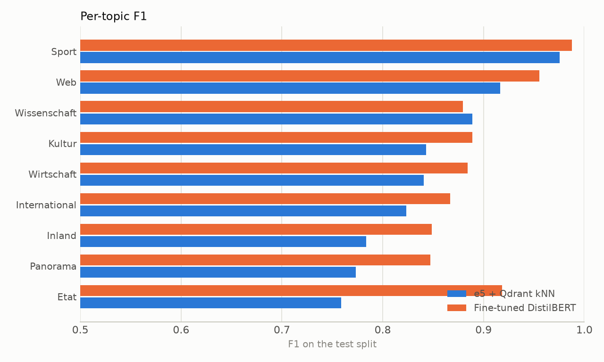
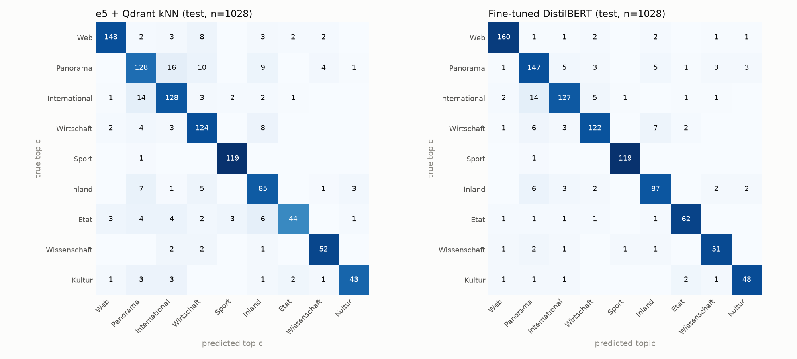
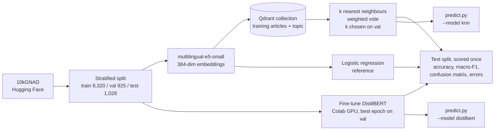
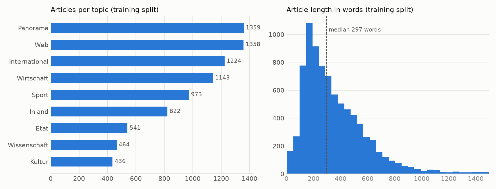

# German Text Classifier

Topic classification of German news articles (10kGNAD, 9 topics, 1,028 test articles), comparing a **vector-database baseline that needs no training** against a **fine-tuned German DistilBERT**. The baseline embeds every article with `multilingual-e5-small`, stores the training articles in **Qdrant**, and labels a new article by a vote among its nearest neighbours. Both models are chosen on a validation split, scored once on the official test split, and served through the same `predict.py`.

[](https://github.com/abhisheklakhani-it/german-text-classifier/actions/workflows/ci.yml)


```console
$ python scripts/predict.py "Der FC Bayern gewinnt das Spiel mit 3:0." "Die Inflation im Euroraum steigt weiter."
{"text": "Der FC Bayern gewinnt das Spiel mit 3:0.", "label": "Sport", "confidence": 0.9942}
{"text": "Die Inflation im Euroraum steigt weiter.", "label": "Wirtschaft", "confidence": 0.9838}

$ python scripts/predict.py --model knn "Apple stellt ein neues iPhone vor."
{"text": "Apple stellt ein neues iPhone vor.", "label": "Web", "confidence": 1.0}
```

## Results

Official 10kGNAD test split, 1,028 articles, scored once after all choices were made on validation. Raw predictions and metrics: [`results/`](results/).

| Model | Training | Test accuracy | Test macro-F1 |
|---|---|---|---|
| e5 embeddings + Qdrant kNN (k = 5, similarity-weighted vote) | none (index build: 5 s) | 0.847 | 0.845 |
| e5 embeddings + logistic regression (C = 10), reference | seconds | 0.856 | 0.857 |
| **Fine-tuned `distilbert-base-german-cased`** (3 epochs) | 4.9 min on a Colab T4 | **0.898** | **0.897** |

Macro-F1 averages the F1 of the nine topics equally, so the small topics (Kultur has 54 test articles) count as much as the large ones (Web has 168).

**Is the difference real?** On the same 1,028 articles, DistilBERT is right on 93 articles where kNN is wrong, and kNN on 41 where DistilBERT is wrong. A McNemar test on these paired results gives p < 0.001, so the 5-point gap is not luck. The kNN vs logistic-regression gap is not significant (73 vs 64 articles, p = 0.49).





**Speed** (measured on an M2 Mac with 8 GB): e5 embeds an article in about 13 ms (MPS GPU) and the Qdrant search takes about 5 ms; DistilBERT on CPU classified the 1,028 test articles in 80 s (about 77 ms per article).

## What I learned

- **Fine-tuning wins most on the topics a lookup confuses.** The biggest gains are *Etat* (0.76 → 0.92 F1) and *Panorama* (0.77 → 0.85). Etat is derStandard's media section; its articles talk about companies, politics and the web, so their nearest neighbours often belong to Wirtschaft, Inland or Web. DistilBERT learns what makes a media story a media story. Sport is easy for both (0.98 vs 0.99).
- **A vector database alone gets close.** With no training at all, embedding the articles and voting among the 5 nearest neighbours reaches 0.845 macro-F1, and training a classifier on the same embeddings adds nothing measurable (0.857, not significant). The remaining 5 points need a model whose weights are updated on the task.
- **Many "errors" are label ambiguity.** In 9 of DistilBERT's 10 most confident mistakes, all three models predict the *same* wrong topic. The labels are the newspaper section each article appeared in: a match report of the Turkish national team is filed under *International*, an EU summit under *Panorama*. 48 test articles are wrong for all three models. [`results/error_analysis.jsonl`](results/error_analysis.jsonl) lists the ten cases.
- **DistilBERT's confidence is useful**, unlike an LLM's self-reported confidence. On the 71% of test articles where it is at least 0.99 confident, it is right 97.5% of the time; below that, 70.8%. A real system could auto-label the confident ones and send the rest to a person.
- **A training setting silently broke the test score.** The first Colab run reported 12.8% test accuracy (chance level) next to 90% on validation. In Transformers 5.x, `train_sampling_strategy="group_by_length"` also reorders the batches of `trainer.predict`, so predictions were compared with labels in a different order. Validation was fine because its labels were reordered with it. The fix switches to sequential order before predicting ([`train_transformer.py`](scripts/train_transformer.py)); the test set was re-scored locally with the saved model. Lesson: when validation and test disagree wildly, suspect the pipeline before the model.
- **Long articles are cut.** 42% of test articles are longer than DistilBERT's 512-token limit (and 48% exceed e5's limit), so both models only see the beginning of them. For news this mostly works, because the topic is clear from the first paragraphs.

## How it works



| File | What it does |
|---|---|
| `src/gnad/data.py` | Loads 10kGNAD; carves a stratified 10% validation split from the training data; the official test split stays untouched |
| `src/gnad/embeddings.py` | Embeds texts with `multilingual-e5-small` (with the `query: ` prefix the model expects), normalised |
| `src/gnad/knn.py` | Qdrant collection in local mode (no server), nearest-neighbour search, majority or similarity-weighted vote |
| `src/gnad/metrics.py` | Accuracy, macro-F1, per-topic scores and confusion matrix, shared by every model |
| `src/gnad/analysis.py` | Loads prediction files, picks the most confident errors, counts agreement between models |
| `src/gnad/predict.py` | `KNNClassifier` and `TransformerClassifier` with the same `predict(texts)` interface |
| `scripts/eda.py` | Class balance and article lengths → [`docs/eda.png`](docs/eda.png) |
| `scripts/embed.py` | Embeds all splits once and caches the vectors |
| `scripts/train_knn.py` | Builds the Qdrant index, grid-searches k and vote weighting on validation, scores on test; also the logistic-regression reference |
| `scripts/train_transformer.py` | Fine-tunes DistilBERT, keeps the epoch with the best validation macro-F1, scores on test |
| `scripts/make_colab_notebook.py` | Generates the Colab notebook from the project's own source files, so Colab trains with the same split and metrics |
| `scripts/compare.py` | Comparison table, charts and error analysis from the saved predictions |
| `scripts/predict.py` | Command-line classifier for either model |



## Running it

```bash
python -m venv .venv && source .venv/bin/activate
pip install -r requirements-dev.txt
```

**Baseline (runs on a laptop)**

```bash
python scripts/eda.py
python scripts/embed.py        # about 2 min on an M2 (MPS), caches vectors in data/embeddings/
python scripts/train_knn.py    # builds data/qdrant/, picks k on validation, scores on test
```

**DistilBERT (needs a GPU)**

```bash
python scripts/make_colab_notebook.py
```

Upload `notebooks/finetune_distilbert_colab.ipynb` to Google Colab, choose a T4 GPU and run all cells (about 15 min including setup). Unzip the downloaded `distilbert_results.zip` into the project folder: it contains `models/distilbert/` and `results/transformer*.json(l)`. On a machine with a GPU you can instead run `python scripts/train_transformer.py` directly.

**Compare and predict**

```bash
python scripts/compare.py
python scripts/predict.py "Der Nationalrat beschließt das neue Budget."               # DistilBERT
python scripts/predict.py --model knn "Die Inflation im Euroraum steigt weiter."
cat articles.txt | python scripts/predict.py -                                        # one article per line
```

**Tests** (16, no network or trained model needed; models are replaced with small fakes)

```bash
pytest
```

## Limitations

- **One run each.** Every model was trained and scored once with seed 42. With 1,028 test articles, the 95% confidence interval of an accuracy near 0.9 is about ±1.8 points, which is why the significance test above matters more than the third decimal.
- **The labels are newspaper sections**, not a topic annotation made for this task, and all articles come from one Austrian newspaper (derStandard.at, 2015–2016). Austrian domestic news is *Inland*; scores on German or Swiss news would likely be lower.
- **Only the first 512 tokens** of each article are used by both models (42–48% of articles are longer).
- **The kNN confidence is a vote share** (often exactly 1.0), not a calibrated probability. DistilBERT's confidence was checked against accuracy, but not calibrated either.
- **The plan's TF-IDF baseline was replaced** by embeddings + Qdrant, a setup closer to what current production systems use; TF-IDF was not measured here.
- **Trained models are not published.** `models/` and `data/` are gitignored: the Qdrant index is rebuilt by the scripts, and DistilBERT by the Colab notebook.

## Next steps

- [ ] Classify long articles from several chunks instead of only the first 512 tokens
- [ ] Repeat the fine-tuning with 3 seeds and report the spread
- [ ] Export DistilBERT to ONNX and measure CPU latency
- [ ] Publish the fine-tuned model on the Hugging Face Hub
